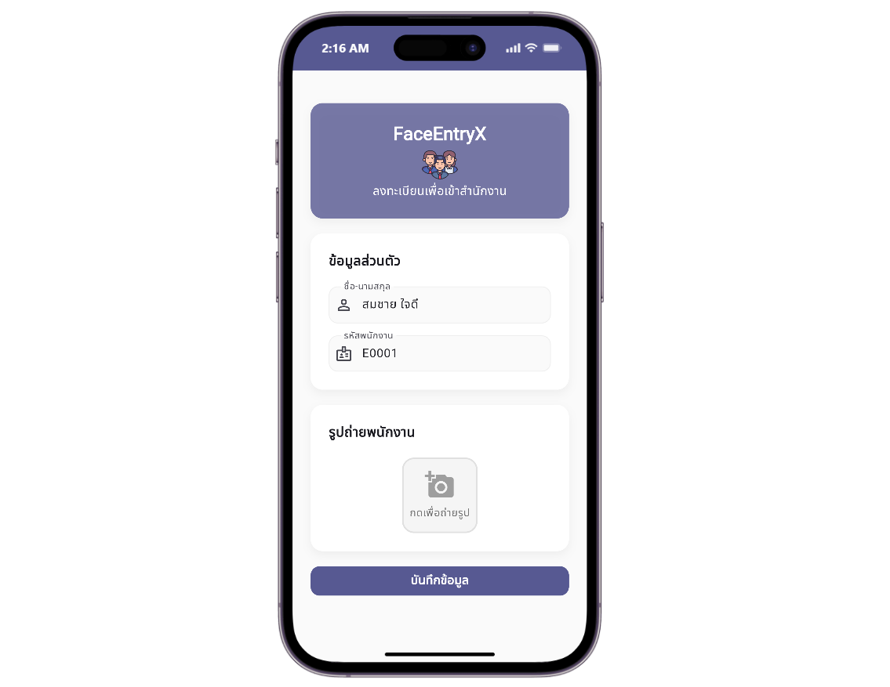
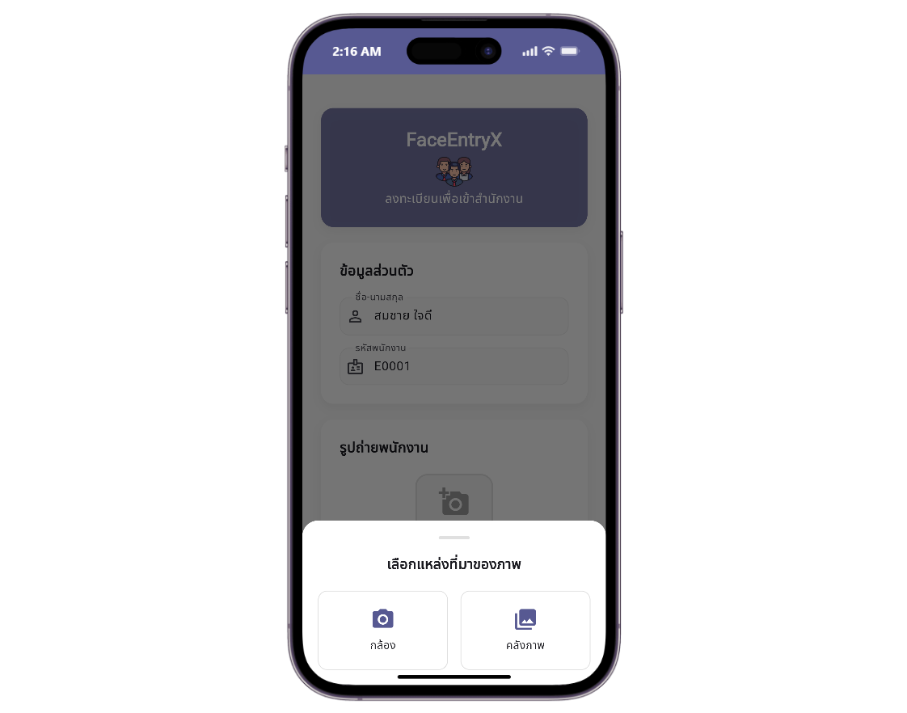

# FaceEntryX

FaceEntryX is a face recognition attendance system. A Flask backend uses the `face_recognition` library to compare employee faces and stores face encodings and attendance logs in MySQL. Employees are registered through one Mobile app, and attendance is recorded by scanning faces with another.

## Screenshots

All screenshots use the same display dimensions.

### Register Application

#### Employee registration form



#### Choose image source



### Face Scan Application

#### Face recognized


## System Overview

```text
Register App (Mobile) ──── POST /api/register: name, employee ID, photo
                                   │
Face Scan App (Mobile) ─── POST /api/recognize: camera frame every 3 seconds
                                   │
                                   ▼
                             Flask Backend
                          (face_recognition, dlib)
                                   │
                                   ▼
                                 MySQL
                      employees, attendance_logs
```

## Features

- Register employees with a name, employee ID, and a photo from the camera or gallery
- Store a 128-dimension face encoding for each employee in MySQL
- Scan faces automatically with the front camera every 3 seconds
- Draw a box around a recognized face and show the employee's name
- Greet recognized employees by voice in Thai with text-to-speech
- Record an attendance log entry each time a face is matched
- Configure the backend and both Mobile apps with `.env` files

> Registering an employee ID that already exists updates that employee's name and face encoding. There is no screen for viewing attendance logs yet; use the API directly.

## Tech Stack

| Component | Technology | Purpose |
|---|---|---|
| Mobile | Flutter, Dart | Register and Face Scan client applications |
| Camera | `camera`, `image_picker` | Live camera preview and photo capture |
| Voice | `flutter_tts` | Thai voice greeting on successful recognition |
| Configuration | `flutter_dotenv`, `python-dotenv` | Load settings from `.env` files |
| API | Python, Flask, Flask-CORS | REST API |
| Face recognition | `face_recognition`, `dlib-bin` | Face detection, encoding, and comparison |
| Database | MySQL, `mysql-connector-python` | Store employees and attendance logs |

## Project Structure

```text
faceentry/
├── backend/
│   ├── api/
│   │   ├── app.py                  # Flask REST API and face recognition
│   │   ├── requirements.txt        # Python dependencies
│   │   └── .env.example            # Example backend configuration
│   └── mysql/
│       └── faceentry.sql           # MySQL schema dump
├── frontend/
│   ├── register/
│   │   ├── lib/                    # Employee registration app source
│   │   ├── assets/                 # Header image and app icon
│   │   ├── pubspec.yaml            # Flutter dependencies
│   │   └── .env.example            # Example backend API URL
│   └── face_scan/
│       ├── lib/                    # Face scan attendance app source
│       ├── assets/                 # App icon
│       ├── pubspec.yaml            # Flutter dependencies
│       └── .env.example            # Example backend API URL
├── docs/
│   └── screenshots/                # Screenshots used in this README
└── README.md
```

## Requirements

- Python 3.12 or later, with support for the listed Python packages
- MySQL 8.0 or later
- Flutter SDK with Dart 3.7 or later
- An Android or iOS device with a front camera for the Face Scan app
- A network-reachable backend IP address when running Flutter on a physical device

## Setup and Run

Set up MySQL and the Flask backend before starting either app.

### 1. Configure MySQL

Create a `faceentry` database and import the schema from `backend/mysql/faceentry.sql`. The SQL dump drops and recreates the `employees` and `attendance_logs` tables; back up any data you need to keep before importing.

You can open and run the SQL file in MySQL Workbench after selecting the `faceentry` database. Configure the database connection values in the backend `.env` file.

Employee IDs are stored as `char(5)`, so use IDs of up to five characters, such as `E0001`.

### 2. Flask Backend

```powershell
cd backend\api
Copy-Item .env.example .env
```

Set your MySQL connection details in `.env`:

```env
DB_HOST=localhost
DB_PORT=3306
DB_USER=root
DB_PASSWORD=your_mysql_password
DB_NAME=faceentry
FLASK_HOST=0.0.0.0
FLASK_PORT=8000
FLASK_DEBUG=True
FACE_TOLERANCE=0.6
```

`FACE_TOLERANCE` is the maximum face distance accepted as a match. Lower values are stricter; `0.6` is the library's standard value. Keep passwords in `.env`; do not commit this file or publish its contents.

Install the dependencies and start the backend:

```powershell
python -m venv .venv
.\.venv\Scripts\Activate.ps1
pip install -r requirements.txt
pip install face-recognition --no-deps
python app.py
```

`face-recognition` is installed separately with `--no-deps` because it depends on the `dlib` source package, which needs a C++ compiler to build. `requirements.txt` installs the prebuilt `dlib-bin` package instead.

By default, the backend listens on `http://localhost:8000`. Configure `FLASK_HOST` and `FLASK_PORT` in `.env` to change the bind address or port.

### 3. Register Application

Open a new terminal:

```powershell
cd frontend\register
Copy-Item .env.example .env
```

Set the backend URL in `frontend/register/.env`, without a trailing slash:

```env
API_BASE_URL=http://192.168.1.101:8000
```

On a physical phone, `localhost` refers to the phone itself. Use the computer's LAN IP address when the backend runs on another device. Make sure both devices are on the same network and that the firewall allows connections to port 8000.

```powershell
flutter pub get
flutter devices
flutter run
```

The `.env` file is bundled into the app at build time. After changing it, stop the app and run `flutter run` again; hot reload does not pick up the new value.

### 4. Face Scan Application

Open a new terminal:

```powershell
cd frontend\face_scan
Copy-Item .env.example .env
```

Set the backend URL in `frontend/face_scan/.env`:

```env
API_BASE_URL=http://192.168.1.101:8000
```

```powershell
flutter pub get
flutter devices
flutter run
```

The app opens the front camera and sends a frame to the backend every 3 seconds. Allow camera access when prompted.

## API Reference

### `POST /api/register`

Registers an employee, or updates an existing one with the same employee ID. Send `multipart/form-data` with the fields `name`, `employee_id`, and `image`.

```powershell
curl -X POST http://localhost:8000/api/register -F "name=Somchai Jaidee" -F "employee_id=E0001" -F "image=@photo.jpg"
```

Returns `200` on success, `400` when a field is missing or no face is found in the image, and `500` on a database or processing error.

### `POST /api/recognize`

Compares the first face in an image with all registered employees. When a face matches, the backend records an attendance log entry. Send `multipart/form-data` with the field `image`.

```powershell
curl -X POST http://localhost:8000/api/recognize -F "image=@photo.jpg"
```

A match returns `200` with `message`, `name`, `employee_id`, `timestamp`, and `face_location` (`[top, right, bottom, left]` in pixels). The endpoint returns `400` when no face is found and `404` when no employee matches.

## Notes

- The API has no authentication. Anyone who can reach the backend can register employees and read attendance logs.
- The backend currently allows requests from all CORS origins. Restrict allowed origins before deploying to production.
- The Face Scan app records a new attendance entry every time a face is matched, so one person standing in front of the camera creates an entry every 3 seconds.
- Face matching uses a single photo per employee and has no liveness check, so a printed photo of a registered employee can be matched.
- Keep database passwords in `.env` files, and never commit them to the repository. The Flutter `.env` files are bundled into the app, so put only non-secret values such as the API URL in them.
- Importing `faceentry.sql` drops and recreates the existing `employees` and `attendance_logs` tables.
